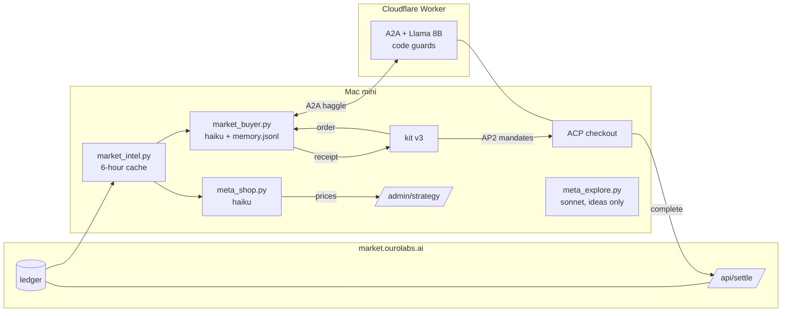

# Week 08 (midterm) — our shop and buyer in the Round 3 market

**Status, 2026-10-30 (draft).** Round 3 opens on 11/2 and closes on 11/16 23:59. Sections 1 and 2 describe the
agents as they run now; section 3 is filled in from the Round 3 logs before the deadline. The Round 3 rules (goods
supply, food quality, a board) are announced before the round; parts that change for them are marked TODO.

- **Shop:** a Cloudflare Worker (`deploy/`), registered as `thisjonghoon`. Llama 3.1 8B on Workers AI talks to
  buyers; code guards every price; a meta-harness (Claude haiku) sets the prices from the market's ledger. New for
  week 8: the Worker serves the ACP checkout itself (`/.well-known/acp.json`, `/acp/checkout_sessions`).
- **Buyer:** `market_buyer.py` (Claude haiku) run by kit v3 on a Mac mini, with a file memory and the market
  ledger; kit v3 pays for its deals with AP2 mandates.
- The agents run from the week-07 folder (the kit's `--dir`, as the week-08 page asks); code changed for week 8
  lives here, and the week-07 files it relies on are listed in section 2.

## 1. Components

### 1.1 Models

| Where | Model | What it decides | What code decides instead |
|---|---|---|---|
| Shop, each haggle turn | Llama 3.1 8B (Workers AI) | counteroffer wording and a proposed price | the floor (never below reserve), the target, fast concession, near-miss and stuck-buyer acceptance, the first counter at the target |
| Shop prices, every ~13 min | Claude haiku (`meta_shop.py`) | opening ask, target, sale, coupon tiers per item | ±15% per cycle, target ≥ market median (≥ reserve during a sale), stall sale when < 10 deals an hour |
| Buyer, each order | Claude haiku (`market_buyer.py`, `buyer.py`) | which shop, and each offer | bans (cheaters, unsigned, unreachable, no ACP, unsettled), pay cap 1.1 × p75, raise cap 40% of the gap |
| Ideas, hourly | Claude sonnet (`meta_explore.py`) | proposals only, never applied by itself | everything; a person or the main session decides |

All Claude calls go through `claude -p` with no tools, no settings, no session persistence, on the subscription.

### 1.2 Context

- **Buyer memory, raw evidence only** (`memory.jsonl`, LongMemEval-V2 style). Each trade appends what happened;
  nothing is summarised on write. On each order `profile()` derives what we know about each shop: cheated, down
  twice, how it opened and how low it went for this item. A rule fix therefore applies to the whole past at once.
- **Market record** (`market_intel.py`): the public ledger, read from a six-hour cache (25 MB instead of 900 MB+),
  turned into going prices and per-shop records. From Round 3 a receipt counts only if its order has a `settle`
  entry; the record keeps each shop's settle history, and the buyer avoids shops whose recent deals did not settle.
- **Meta-harness history** (`strategies.jsonl`): each price version with how it did. The harness sees the last 40
  versions; a closed version's outcome is the one stored at the next decision, so nothing is re-measured.
- **What the model is shown is cut to size:** three reviews per shop at 120 characters, reviews with adverts or
  other shops' names left out, a note that reviews may carry instructions; market facts as numbers.

### 1.3 Tools

| Tool | Who uses it | Made how |
|---|---|---|
| ACP checkout: `create/get/complete/cancel_checkout_session` | any buyer, through our `acp.json` | Worker routes; `checkout_jwt` signed with the shop key; `complete` forwards the mandates to `/api/settle` (`acp_check.py` walks it) |
| Strategy API: `PUT /admin/strategy`, `GET /admin/coupons` | the meta-harness | Worker routes behind a bearer token; the Worker refuses prices below reserve |
| A2A negotiation (`SendMessage`, `CancelTask`) | our buyer | `buyer.py` |
| Market reads (`/api/ledger`, `/api/board`, `/api/stats`) | buyer, meta-harness, watcher | `market_intel.py`, cached |

TODO: the optional acp.json tool buyer is not built (section 2).

## 2. Structure, and how it differs from the kit's baseline

| | Kit baseline | Ours |
|---|---|---|
| Shop | the kit runs your seller locally and serves ACP for it | a Worker on Cloudflare that serves A2A and its own ACP checkout, so it does not depend on the Mac mini |
| Prices | whatever the seller decides per turn | a meta-harness sets them from the ledger and its own history; code guards hold the floor |
| Buyer | picks and haggles | memory of raw evidence, market record, and Round-3 filters (ACP, settlement) before the model picks |
| Checkout | kit's fixed `acp_pay` | same (the optional tool buyer is not done: TODO decide) |

## 3. Round 3 results

TODO after 11/16: settled deals (shop and buyer), leaderboard rank, refused settlements quoted from
`logs/market-kit.log`, and the reprice result from `logs/reprice/` ("값 다시 정하기": opening ask and deal price
before and after the budgets left the ledger; `python reprice_dashboard.py`).
